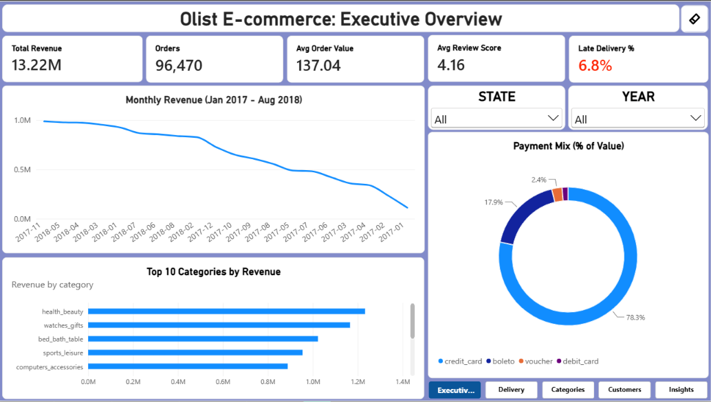
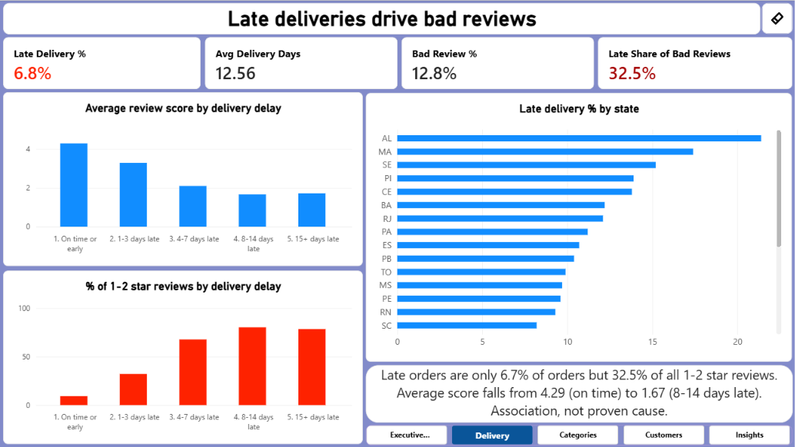
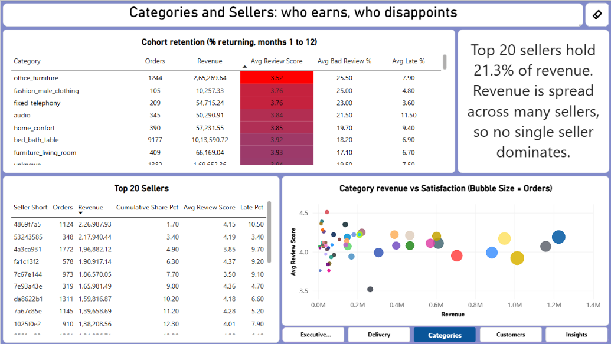
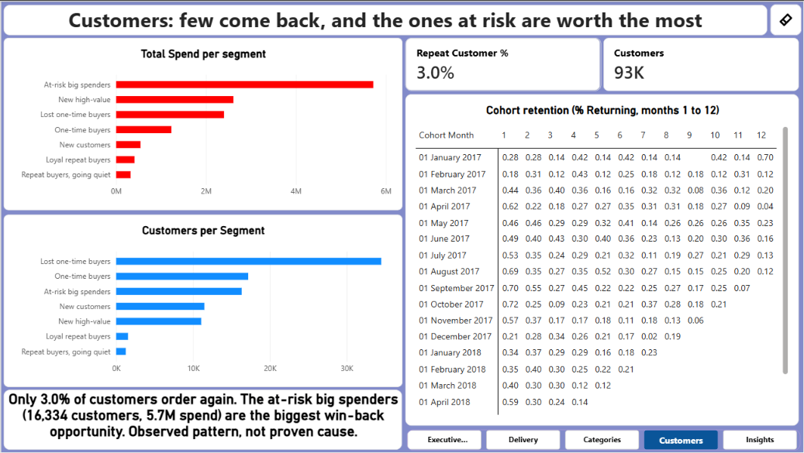
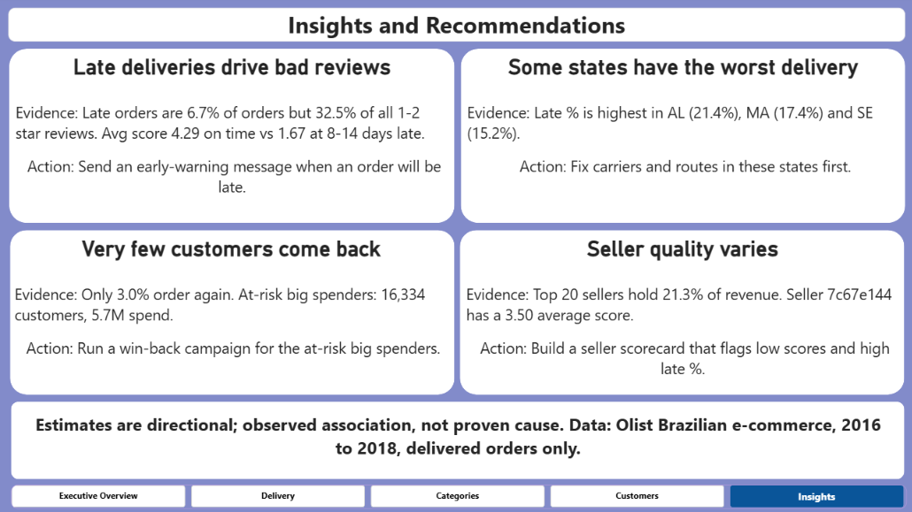

# Olist E-commerce Analysis: Why Do Customers Leave 1-Star Reviews?

SQL (PostgreSQL) + Python + Power BI analysis of ~100K real orders from the Olist Brazilian marketplace (2016-2018).

> **Key finding:** late deliveries are only **6.7%** of reviewed orders but **32.5%** of all 1-2 star reviews.
> The average review score drops from **4.29** (on time) to **2.27** (late).

## Dashboard







## Business questions

1. How are revenue and orders trending month by month?
2. Which categories earn the most, and which disappoint customers?
3. Which states have the worst delivery performance?
4. Does late delivery lower review scores, and by how much?
5. How concentrated is seller revenue?
6. How many customers come back, and which customer segments matter most?

## Key findings

| # | Finding | Evidence |
|---|---|---|
| 1 | Late deliveries are strongly associated with bad reviews | Late orders are 6.7% of reviewed orders but 32.5% of the 12,272 one- and two-star reviews. Average score is 4.29 on time vs 2.27 late. 1-2 star share is 9.3% on time vs 62.4% late. |
| 2 | Longer delays hurt more | Average score by delay bucket: 4.29 (on time), 3.29 (1-3 days), 2.10 (4-7 days), 1.67 (8-14 days), 1.72 (15+ days). 1-star share rises from 6.6% to 70.6% (8-14 days late). |
| 3 | Some states are much worse | Late delivery %: AL 21.4%, MA 17.4%, SE 15.2% (states with 50+ orders). |
| 4 | Very few customers return | Only 3.00% of customers (2,801 of 93,350) ordered more than once. Monthly cohort return rates stay below 1% in months 1-12. |
| 5 | The biggest win-back opportunity is at-risk big spenders | 16,334 customers with 5.72M total spend, last order about 300 days before the snapshot. |
| 6 | Revenue is spread across many sellers | Top 20 sellers hold 21.3% of revenue. The largest seller holds 1.72%. |
| 7 | Growth comes from order volume | Monthly revenue rose from 111,798 (Jan 2017) to 987,648 (Nov 2017, Black Friday) and flattened around 0.84M-0.98M in 2018. Average order value stayed in a narrow range. |

Other results:

- Delay vs review score: Spearman correlation -0.176 (delivery days vs score: -0.235). Weak to moderate overall because 93% of orders arrive on time; the effect is concentrated in the late group.
- Credit card is 78.3% of payment value (3.5 average instalments), boleto 17.9%.
- Top categories by revenue: health_beauty (1,233,132), watches_gifts (1,165,899), bed_bath_table (1,023,435).
- Lowest-rated large category: office_furniture (average score 3.52, 25.5% bad reviews, 7.9% late). Lateness alone does not explain it.

## Recommendations

1. **Early-warning message:** notify customers when an order is going to be late, before they leave a review.
2. **Fix logistics where it hurts most:** prioritise carriers and routes for AL, MA and SE.
3. **Win-back campaign** for the "At-risk big spenders" segment (16,334 customers, 5.72M spend).
4. **Seller scorecard:** flag high-revenue sellers with a low review score or high late % (for example seller 7c67e144: 3.50 average score, 9.1% late).

## Tech stack

PostgreSQL | SQL (CTEs, window functions, views, cohort and RFM analysis) | Python (pandas, matplotlib, seaborn, SQLAlchemy) | Power BI (DAX, star schema) | GitHub

## Project structure

```
sql/         table creation, data load, data quality checks, views, 11 analysis queries
notebooks/   db.py (database connection), analysis.py (charts, statistics, CSV exports)
output/      charts (8 PNG) and CSV exports used by Power BI
powerbi/     Olist_Ecommerce_Dashboard.pbix
docs/        metric definitions and findings log
screenshots/ dashboard images
```

## How to reproduce

1. Download the dataset from Kaggle: https://www.kaggle.com/datasets/olistbr/brazilian-ecommerce and put the 9 CSV files in `data/raw/`.
2. Install PostgreSQL and create a database named `olist`.
3. In psql, from the project root, run `sql/01_create_tables.sql`, `sql/02_load_data.sql` and `sql/05_views.sql`.
4. Set the `OLIST_DB_PASSWORD` environment variable to your postgres password (it is read in `notebooks/db.py`; no password is stored in the repository).
5. Install the packages: `pip install pandas numpy matplotlib seaborn scipy sqlalchemy psycopg2-binary`
6. Run `python notebooks/analysis.py` to create the charts and the CSV exports in `output/`.
7. Open `powerbi/Olist_Ecommerce_Dashboard.pbix` in Power BI Desktop and refresh the CSV paths if needed.

## Data quality notes

- 96,470 delivered orders with a delivery date were analysed; 95,824 of them have a review (0.67% have none).
- Orders can have more than one review, so the latest review per order is used.
- Payments have several rows per order, so revenue is calculated from order items, never from joined payments.
- The first and last months of the data are incomplete, so trends use Jan 2017 to Aug 2018.

## Metric definitions

See [docs/metric_definitions.md](docs/metric_definitions.md).

## Limitations

- Reviews are voluntary, so the analysis shows **association, not proven cause**. About two thirds of bad reviews come from orders that were on time, so product quality and other factors matter too.
- Data covers 2016-2018 and a single Brazilian marketplace.
- Orders without a delivery date or a review are excluded from the relevant metrics.

## Data source

Brazilian E-Commerce Public Dataset by Olist (Kaggle). Check the licence on the Kaggle page. Raw data is not included in this repository.

## Author

**Gokul Selvam K A** | Coimbatore | [LinkedIn](https://linkedin.com/in/gokul-selvam07) | [GitHub](https://github.com/gokularumainathan06)
